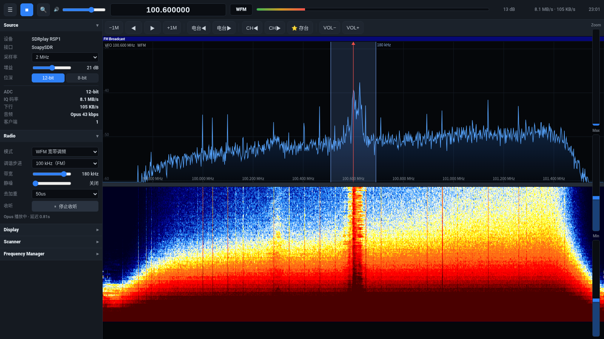

# SDR-webui · RSP1 网页接收机

把 SDRplay RSP1 变成一个**浏览器里的 SDR++ 风格接收机**：频谱 + 瀑布 + 8 种解调 + 自动搜台 + 与 SDR++ 互通的书签，音频在服务端编码成 Opus 再下发，浏览器只收 ~20 KB/s。



## 特性

**界面（仿 SDR++）**
- 顶栏：启停、音量、大号频率（可输入）、模式、SNR 条、码率、时钟
- 右侧 `Zoom` / `Max` / `Min` 三根竖滑条，滑块跟手，`Max`/`Min` 各管频谱一端
- 频谱：点击/拖动调谐、**0.1 MHz 吸附**、滚轮缩放 1–32×、峰值保持、带宽色块可拖边缘改带宽、扫描结果三角标记
- 瀑布：SDR++ 原生色表、与缩放联动、改变大小时保留历史
- 左侧可折叠面板：Source / Radio / Display / Scanner / Frequency Manager
- 收音机按键条：`−1M ◀ ▶ +1M`、`电台◀ ▶`（在扫描结果里跳）、`CH◀ ▶`（翻书签）、`⭐ 存台`、`VOL±`

**接收**
- 8 种解调：`WFM` `NFM` `AM` `USB` `LSB` `CW` `DSB` `RAW`，带宽 300 Hz–500 kHz 可调，静噪、去加重
- 采样率 1/2/4/6/8 MSps，12-bit / 8-bit 模拟
- **按需采集**：没人开页面 → 设备完全释放；开了页面也要点 ▶ 才开始；关页面自动停

**音频**
- 服务端 Opus 编码（ffmpeg），浏览器 MSE 播放，**下行 ≈ 18–20 KB/s**（不传原始 IQ）
- 自适应缓冲（0.45–0.9 s）+ 播放速率微调，实测 0 次断流

**数据**
- 书签文件与 SDR++ 的 `frequency_manager_config.json` **同构**，导入/导出互通
- 自动搜台：多帧平均 + 局部噪声底 + 谱宽判据 + 0.1 MHz 栅格
- 波段计划/色表直接复用 SDR++ 的 `res/` 资源

## 架构

```
                    ┌──────────── 浏览器 (static/index.html) ────────────┐
                    │  Canvas 频谱/瀑布 · WebAudio/MSE · 书签/扫描 UI      │
                    └───────▲──────────────────────────────┬──────────────┘
                  WS(二进制 S/A/O + JSON)                  │ HTTP(静态/API)
                    ┌───────┴──────────────────────────────▼──────────────┐
   SoapySDR ──────► │  sdrwebd (C++)  或  server.py (Python)              │
   RSP1 CS16        │   ├─ 采集线程：read → 抽取(D≈1MHz) → 解调 → ~48k PCM │
                    │   ├─ FFT：16384 点 → 1024 bins → uint8(dB+140)      │
                    │   ├─ Opus：每客户端一路 ffmpeg 子进程 → WebM/Opus    │
                    │   └─ epoll 网络循环：HTTP + WebSocket + 书签/扫描 API │
                    └──────────────────────────────────────────────────────┘
```

两个后端**协议完全一致**，前端可以无缝切换：

| 后端 | 文件 | CPU（2 MHz / 8 MHz） |
|---|---|---|
| **C++（默认）** | `cpp/sdrwebd` | **~13% / ~20%** |
| Python（备用） | `server.py` | ~34% / ~100%（8 MHz 会丢样本） |

## 快速开始

### 依赖

```bash
sudo apt install libsoapysdr-dev libfftw3-dev nlohmann-json3-dev ffmpeg \
                 python3-aiohttp python3-numpy python3-scipy
# SDRplay API + SoapySDRPlay 模块需按 SDRplay 官方文档安装
```

### C++ 后端（推荐）

```bash
cd cpp && make            # 产出 ./sdrwebd
./sdrwebd --port 8095     # 浏览器打开 http://<主机>:8095/
```

### Python 后端

```bash
python3 server.py --port 8095
```

### 开机自启

见 [`deploy/README.md`](deploy/README.md)。

## 协议

WebSocket `/ws`：

| 方向 | 消息 | 说明 |
|---|---|---|
| S→C | `{"type":"hello"}` / `{"type":"status",…}` | 每 0.5 s 推一次状态（频率/码率/SNR/客户端数…） |
| S→C | 二进制 `'S'` + u16 长度 + 1024×(dB+140) | 频谱帧，~12 fps |
| S→C | 二进制 `'A'` + u16 样本数 + int16 PCM | 音频（PCM 客户端） |
| S→C | 二进制 `'O'` + u16 长度 + WebM/Opus 分片 | 音频（Opus 客户端，MSE 播放） |
| S→C | `{"type":"scan","stations":[{"freq","db"}]}` | 扫描结果 |
| C→S | `{"cmd":"set","freq":100.6e6,"mode":"WFM","bw":180000,…}` | 改参数 |
| C→S | `{"cmd":"scan"}` / `{"cmd":"status"}` | 触发扫描 / 主动取状态 |

HTTP API：`GET /api/res`（波段+色表清单）、`GET|POST /api/bookmarks`、
`GET /api/bookmarks/export`、`POST /api/bookmarks/import`、`POST /api/bookmarks/scan`。

## 目录

```
server.py               Python 后端（备用，功能最全）
static/index.html       前端（单文件，无构建）
res/bandplans|colormaps SDR++ 原生波段计划与色表（见 NOTICE）
cpp/sdrwebd.cpp         C++ 后端（单文件 ~1500 行）
cpp/Makefile
deploy/                 systemd 单元
docs/screenshot.png
bookmarks.example.json  书签文件示例（与 SDR++ 同构）
```

## 性能实测

| 项目 | 数值 |
|---|---|
| CPU（C++，2 MHz / 8 MHz） | 13% / 20%（单核占比） |
| 下行带宽（Opus） | 18–20 KB/s |
| 音频延迟 | 0.6–0.9 s（自适应缓冲） |
| 播放连续性 | 15 s 窗口 0 次断流（2 MHz / 8 MHz 均验证） |
| 扫描耗时 | 87.5–108 MHz 约 1–2 s（2 MHz） |

## 排错

- **打不开设备 / `no available RSP devices found`**：SDRplay API 服务卡死时先
  `sudo systemctl restart sdrplay`；仍不行就对 USB 设备做一次 reset（`USBDEVFS_RESET`），
  见 `tools/usbreset.c`。
- **多标签页同时打开**：调谐器是共享的，后发的命令生效；关掉多余标签页。
- **没声音**：先点 ▶ 开始采集，再点「开始收听」；浏览器静音/自动播放策略也会拦。
- **书签不持久**：确认运行目录可写（`bookmarks.json` 与 `server.py`/`sdrwebd` 同目录）。

## 许可

GPL-3.0（见 [LICENSE](LICENSE)）。`res/` 下的波段计划与色表来自
[SDR++](https://github.com/AlexandreRouma/SDRPlusPlus)（GPL-3.0），详见 [NOTICE](NOTICE)。
